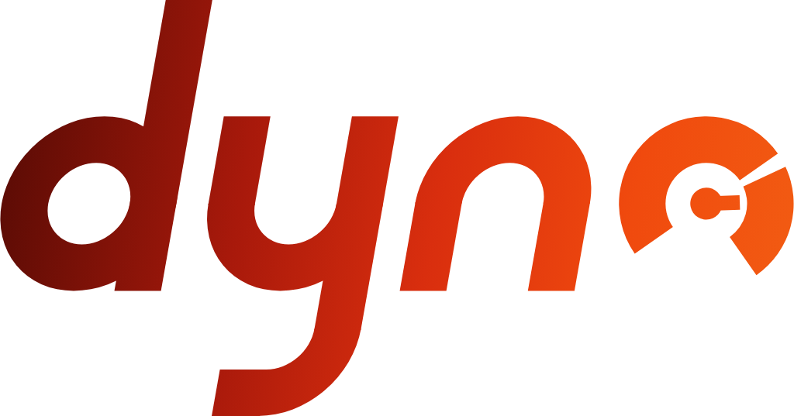

<picture>
  <source media="(prefers-color-scheme: dark)" srcset="brand/png/dyno-redhot-1024.png">
  
</picture>

# dyno

A Rust command-line tool for casino games that run in iframes. Its first job is to say how much memory a game will use on an iPhone, before a player loads it.

**Status:** early, and the result shape may still change before 1.0. `dyno check ./dist` scans a build and gives the static measures, rules and fixes. `dyno check <launch-url>` runs the game in Chromium and gives the lab measures, and `dyno check ./dist --browser` serves the build to Chromium for the same run. `dyno compare` diffs two results. `dyno mcp` lets an AI coding tool run the same checks. The phone calibration, and so the memory model, comes next.

## Build

Needs Rust 1.97 or later. CI uses 1.99.1.

```sh
cargo build                      # the binary is target/debug/dyno
cargo test --workspace           # unit, golden and snapshot tests
cargo run -- check path/to/dist  # the static scan of a build folder or .zip
cargo run -- check path/to/dist http://127.0.0.1:5173/  # and a browser run of the game
cargo run -- compare base.json head.json  # the diff of two results
```

Some tests compare the output with saved copies in the repo, and fail when the two are different. When you change the output on purpose, run this command to replace the saved copies with the new output. Then read the diff before you commit:

```sh
DYNO_UPDATE_GENERATED=1 INSTA_UPDATE=always cargo test --workspace
```

`DYNO_UPDATE_GENERATED=1` rewrites the JSON Schema in `packages/schema/json/`, the TypeScript types in `packages/schema/ts/` and the golden result hashes in `fixtures/golden-hashes.json`. `INSTA_UPDATE=always` rewrites the saved command output (the snapshots) in `crates/*/tests/snapshots/`.

A browser run needs Chromium. dyno looks for `chromium`, `chromium-browser`, `google-chrome` and `google-chrome-stable` on the PATH, then Google Chrome and Chromium in `/Applications`. Set `DYNO_CHROMIUM` to the binary to use another. Chromium runs with its sandbox, because a run loads code that dyno did not write. In a container with no user namespaces, such as a self-hosted CI runner in Docker with the default seccomp profile, Chromium finds no sandbox and exits; set `DYNO_CHROMIUM_SANDBOX=off` there to run it without one. The tests that start Chromium, and the one that needs Node 22.18 or later to check the probe, are ignored by default:

```sh
cargo test -p dyno-cdp -- --ignored
```

See [`docs/cli.md`](docs/cli.md) for the commands and [`docs/architecture.md`](docs/architecture.md) for the crates.

### The checks CI runs

[mise](https://mise.jdx.dev) installs the tools that CI uses, at the same versions, and runs the same checks. CI runs these tasks too, so a check that passes here passes there:

```sh
mise install     # Rust, Node, the linters and formatters, cargo-deny, cargo-about, cargo-dist, cargo-llvm-cov, knope
mise run health  # formatting, lint and types in every language, licences and advisories, the workflows
mise run test    # the tests, and a build with the minimum Rust version
mise run coverage  # the tests' coverage, and the check CI makes (CONTRIBUTING.md, "Coverage")
mise run build   # the release plan
mise tasks       # every task
```

## Repository layout

| Path                                        | What it holds                                                                                                                                                                                                                                                                    |
| ------------------------------------------- | -------------------------------------------------------------------------------------------------------------------------------------------------------------------------------------------------------------------------------------------------------------------------------- |
| `crates/`                                   | The Rust crates. `dyno-cli` is the `dyno` binary. [`docs/architecture.md`](docs/architecture.md) says what each crate does.                                                                                                                                                      |
| `packages/schema/`                          | The npm package `@dyno-labs/schema`: the JSON Schema in `json/` and the TypeScript types in `ts/`. Both are generated from `dyno-schema`.                                                                                                                                        |
| `fixtures/`                                 | Synthetic game builds for the tests, the values each must give, and `golden-hashes.json`, the `result_hash` of each.                                                                                                                                                             |
| `examples/`                                 | An example budget file.                                                                                                                                                                                                                                                          |
| `docs/`                                     | The commands, the architecture, the design of the static scan, and how to release.                                                                                                                                                                                               |
| `brand/`                                    | The logo, the icons and the terminal banner.                                                                                                                                                                                                                                     |
| `mise.toml`                                 | The pinned tools, and the tasks that CI runs.                                                                                                                                                                                                                                    |
| `package.json`                              | TypeScript, and the types that the probe build and the fixture apps need. `tsconfig.base.json` holds the settings each TypeScript project shares.                                                                                                                                |
| `.oxfmtrc.json`, `.oxlintrc.json`           | The files that the formatter (oxfmt) and the TypeScript linter (oxlint) leave out. Both use their defaults.                                                                                                                                                                      |
| `.changeset/`, `CHANGELOG.md`, `knope.toml` | The change files of the next release, the notes of every release, and the knope settings that turn one into the other. See [`docs/releasing.md`](docs/releasing.md).                                                                                                             |
| `.github/workflows/`                        | CI: `health.yml` (static checks), `test.yml` (tests and their coverage), `change-file.yml` (a change file on each pull request), `release-pr.yml` (the release pull request and the tags), `release.yml` (the release, generated by cargo-dist) and `npm.yml` (the npm package). |
| `.github/coverage/`                         | The coverage report and its check (`report.ts`), the floors of each part (`engine.json`), and the scripts that get main's report and post the pull request comment.                                                                                                              |

## Licence

dyno is under either of these licences, at your option:

- the Apache License, Version 2.0 ([`LICENSE-APACHE`](LICENSE-APACHE));
- the MIT licence ([`LICENSE-MIT`](LICENSE-MIT)).

The notices for the open source code inside the binary are in [`THIRD_PARTY_NOTICES.md`](THIRD_PARTY_NOTICES.md). The name and the logos are not covered by the code licence: see [`TRADEMARKS.md`](TRADEMARKS.md). To contribute, see [`CONTRIBUTING.md`](CONTRIBUTING.md). To report a security problem, see [`SECURITY.md`](SECURITY.md).
